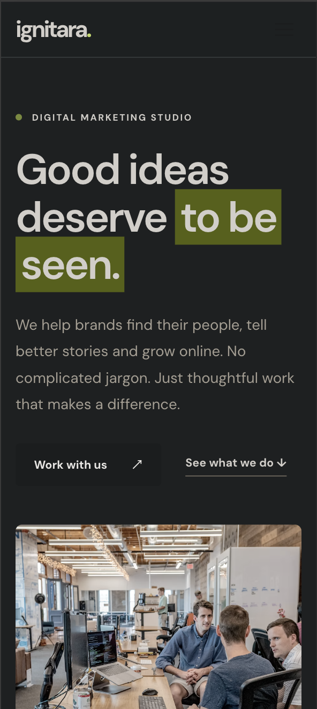
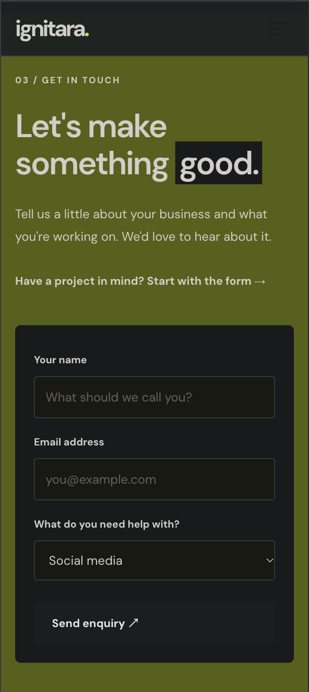

# Ignitara Media

A responsive website I built for **Ignitara Media**, a digital marketing agency.

The idea behind this project was to create a clean, modern website where visitors could learn about the agency, explore its services, and get in touch.

I wanted the design to feel professional without being overly complicated, so I went with a dark theme, simple navigation, and a layout that works across different screen sizes.

## About the Project

The website introduces Ignitara Media and highlights the services it offers, including social media marketing, SEO, and performance advertising.

Along with the frontend, I also worked on a small backend using Node.js and Express to handle customer enquiries.

This project gave me experience building a business-focused website and connecting a frontend to a backend.

## Features

- Responsive layout for desktop and mobile devices
- Modern dark-themed design
- Services section with individual cards
- Smooth scrolling between sections
- Customer enquiry form
- Backend API to handle registrations
- Email notifications using Nodemailer
- Local JSON storage for submitted enquiries

## Screenshots

## Screenshots

### Desktop View

.png>)
.png>)

### Mobile View

.png>)
.png>)

### Mobile View

<p float="left">
  
  
</p>

## Technologies Used

**Frontend**

- HTML
- CSS
- JavaScript
- Tailwind CSS

**Backend**

- Node.js
- Express.js
- Nodemailer

## Running the Project Locally

First, clone the repository:

```bash
git clone https://github.com/Skiller969/ignitra-website2.git
cd ignitra-website2
```

Install the required dependencies:

```bash
npm install
```

If you want to enable email notifications, create a `.env` file in the project folder and add your email configuration:

```env
EMAIL_USER=
EMAIL_PASS=
ALERT_RECEIVER=
```

The email configuration is optional. The registration system can save enquiries locally without it.

Start the server:

```bash
npm start
```

Then open `http://localhost:3000` in your browser.

To rebuild the Tailwind CSS while making changes, run this in another terminal:

```bash
npm run dev
```

## Project Structure

```text
ignitra-website2/
├── public/
│   ├── css/
│   ├── js/
│   └── index.html
├── src/
│   └── input.css
├── server.js
├── package.json
├── tailwind.config.js
└── README.md
```

## Screenshots

I'll be adding screenshots of the website here.

## What I Learned

Working on this project helped me improve my frontend development skills, especially when it came to building responsive layouts and organizing a website into different sections.

I also got to work with Express.js and Nodemailer to understand how form submissions can be handled on the backend.

## Future Improvements

There are still a few things I'd like to improve:

- Better form validation and error handling
- Database integration instead of local JSON storage
- Accessibility improvements
- Further mobile and performance optimizations

## Developer

**Sarthak Pawar**

I'm a web developer currently working with HTML, CSS, JavaScript, Tailwind CSS, React, and Next.js.

I'm interested in building responsive websites and practical web applications.

**GitHub:** Skiller969
